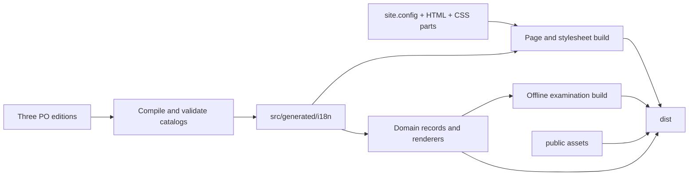

# Source, translation and publication architecture

The site remains a dependency-free static university portal. Node.js 22 or newer
builds it; the browser runs native modules. There is no framework, gettext service,
remote translation call or new visitor-record format.

## Repository map

```text
src/
  templates/           shared HTML shell
  sections/            authored institutional HTML, with explicit message keys
  data/                domain records, identifiers, relationships and rules
  js/                  models, stores, controllers and focused renderers
  styles/              small stylesheet manifests and feature-specific parts
  generated/i18n/      compiled browser/Node catalogs; ignored, never hand-edit
locales/
  en/                  English source PO catalogs; default public edition
  zh-Hant/             Traditional Chinese PO catalogs
  ja/                  Japanese PO catalogs
  templates/           generated POT files for gettext editors; ignored
public/                authored files copied unchanged to the published root
  assets/              original illustrations, recruitment posters and crest
  .nojekyll
scripts/
  build/               HTML, default copy, stylesheet includes and publication
  i18n/                PO parser, synchronization, validation and compilation
  checks/              shared validator helpers
  tests/               deterministic build-tool regression tests
  browser/             shared browser-tool helpers, including free port selection
docs/                  architecture, operating rules, research and history
site.config.mjs        pages, sections, style order, metadata and navigation keys
dist/                  complete publication; ignored and safe to regenerate
```

`dist/` contains the same public paths as the earlier repository-root release:
`index.html`, `academics.html`, the other pages, `assets/css/`, `assets/images/`,
`downloads/gaokao/` and the required `src/js`, `src/data`, `src/generated` modules.
It excludes source HTML, stylesheet parts, PO catalogs, research and build tools.
Do not introduce an `/html/` URL prefix when moving the build directory.

## Build and loading



`scripts/build.mjs` orders the build so catalogs exist before modules import
domain records. It prepares `dist/`, generates pages/CSS and offline papers, then
copies runtime modules. A build starts from an empty publication directory;
removed pages and modules cannot linger there. `npm run check:publication` checks
relative assets and imports and rejects authoring material in the artifact.

CSS manifests use local build-time includes, for example:

```css
/* @include ./clinic/base.css */
/* @include ./clinic/prescription.css */
```

Includes retain declaration order, reject cycles and stay within `src/styles/`.
They do not become browser `@import` requests. The published shared and page
bundles keep their existing names.

`npm run dev` watches `src/`, `locales/`, `public/` and `site.config.mjs`. Builds
are serialized and generated catalogs do not trigger a rebuild loop. The server
serves `dist/`; `npm run preview` serves an already built artifact.

Browser tests and captures choose free local server/debugger ports so existing
development services can keep running. `BROWSER_SITE_PORT` / `BROWSER_DEBUG_PORT`
and the corresponding `CAPTURE_*` variables override them when needed. Availability
checks compare the UI with shared live state, including legitimate closed-hours
empty results.

## Registration and ownership

These registries have different responsibilities:

| Authority | Responsibility |
| --- | --- |
| `site.config.mjs` | Page/section composition, style subsets and page copy keys |
| `src/js/feature-registry.js` | DOM selector, UI module and initializer |
| `src/js/domain-registry.js` | Search/BBS capabilities and domain projections |
| `src/js/site-router.js`, `deep-links.js` | Canonical page/hash ownership and browser history |
| `src/data/event-contracts.js` | Official causal events |
| `src/data/local-records.js` | Durable on-device storage keys |

New features still follow the data → model/store → official event → focused UI
pattern. PO catalogs own wording; domain modules own IDs, credits, thresholds,
relationships, storage and rules. Do not move those facts into PO entries. Models
keep accepting older records. Search, BBS and Hieda remain projections.

The spell-card flight preview is isolated in `src/js/spellcard-sandbox.js`; its
controller passes the host element, assessment getter and translated controls.
The animation owns its input and teardown lifecycle without owning saved designs.

## Translation maintenance

Read [the catalog guide](../locales/README.md). Catalogs are partitioned by owner:
`shell/` for global markup and navigation, `data/` for institutional records,
`ui/` for controls and dynamic replies, and `build/` for offline documents.

The structure follows the useful parts of [REA's gettext workflow](https://github.com/morluto/rea/tree/main/website/locales):
source references, stable context, translator notes, pending review and generated
publication. The university retains its three existing locale tags and language
switcher rather than adding language-prefixed routes.

Every message has a stable `msgctxt` and an English `msgid` reference. Editors
change `msgstr`. Changing English wording requires `npm run i18n:sync`, which
updates the reference, preserves other translations and marks them fuzzy for
review. Removed entries remain as obsolete translation memory. A build rejects
missing, empty, fuzzy, stale or mismatched-placeholder translations.

Static markup uses `data-i18n` and translated-attribute keys. Mixed-content text
can use `<!-- i18n:messageKey -->` immediately before a text node; this preserves
links, emphasis and existing DOM structure. Both the build and language switch
use the explicit key. Public source fallbacks stay readable, while generated
defaults come from the current English PO, including page metadata. Visitor-authored prose
never participates in a source-text translation lookup.

## Git history and publication

The campus-history owner is still `src/data/campus-history.js`; its four narrative
fields now resolve from `locales/*/data/campus-history.po`. Backfill the previous
main SHA before adding one planned entry. Stable history IDs, archive IDs and exact
Git subjects remain in source code. The checker explicitly reads first-parent
`main`, or fetched `origin/main` in a detached CI checkout.

The workflow in `.github/workflows/pages.yml` validates source and browser flows,
uploads **only `dist/`**, and deploys only `main`. Checkout fetches full history.
The publication directory becomes the Pages root, preserving public URLs.
Browser acceptance installs the explicitly pinned Chrome for Testing build and
its Linux dependencies; update the pin together with a successful local browser
run. Failed browser runs preserve startup output and process status in CI logs.

Repository Settings → Pages → Source uses **GitHub Actions**, migrated from
**Deploy from a branch** for release 0.31.0. A new deployment must retain that
setting: editing the workflow alone does not change the Pages publishing source.

See [GitHub's custom-workflow documentation](https://docs.github.com/en/pages/getting-started-with-github-pages/using-custom-workflows-with-github-pages).
